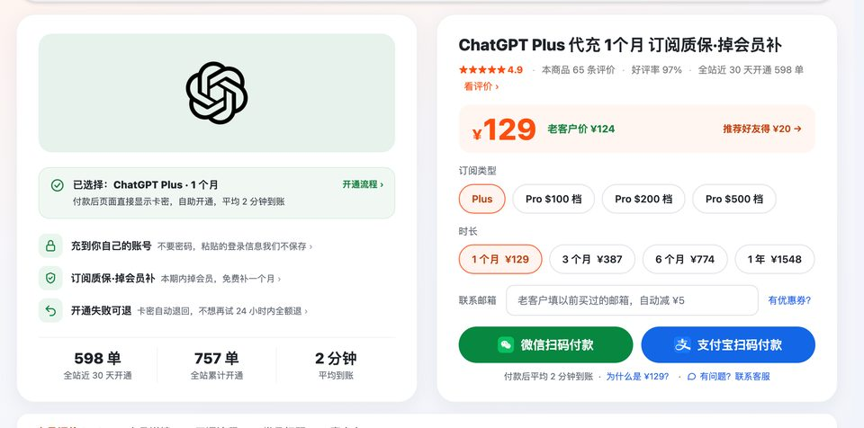
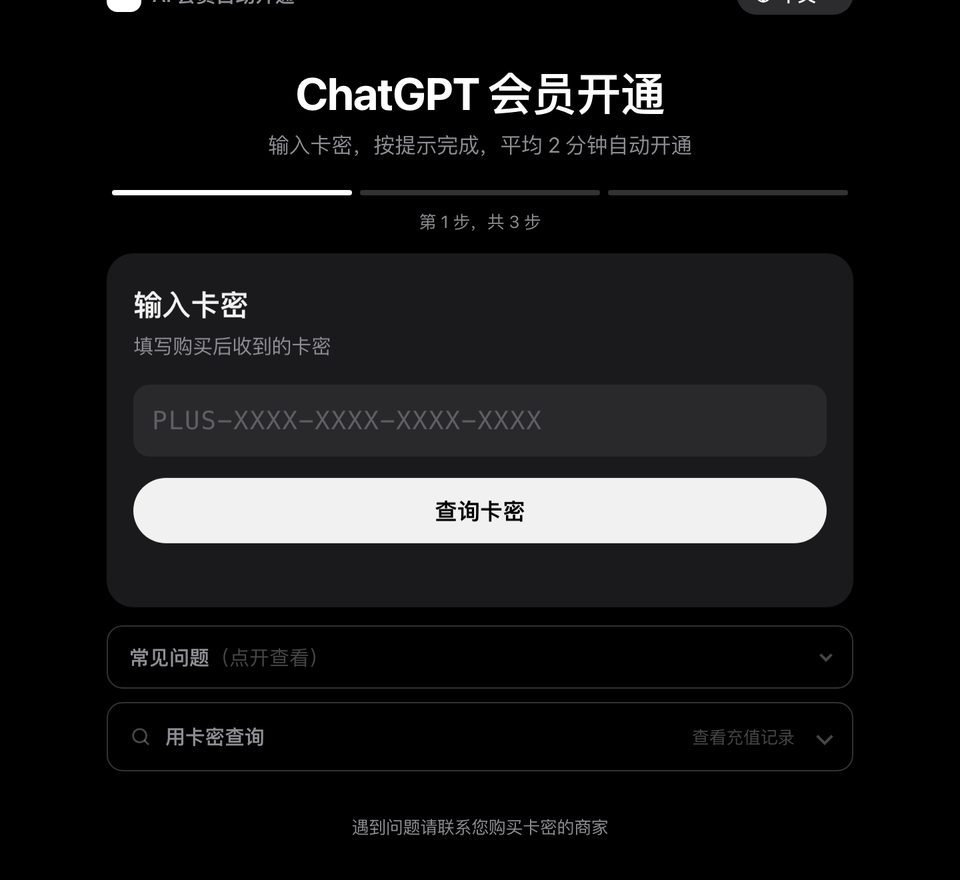
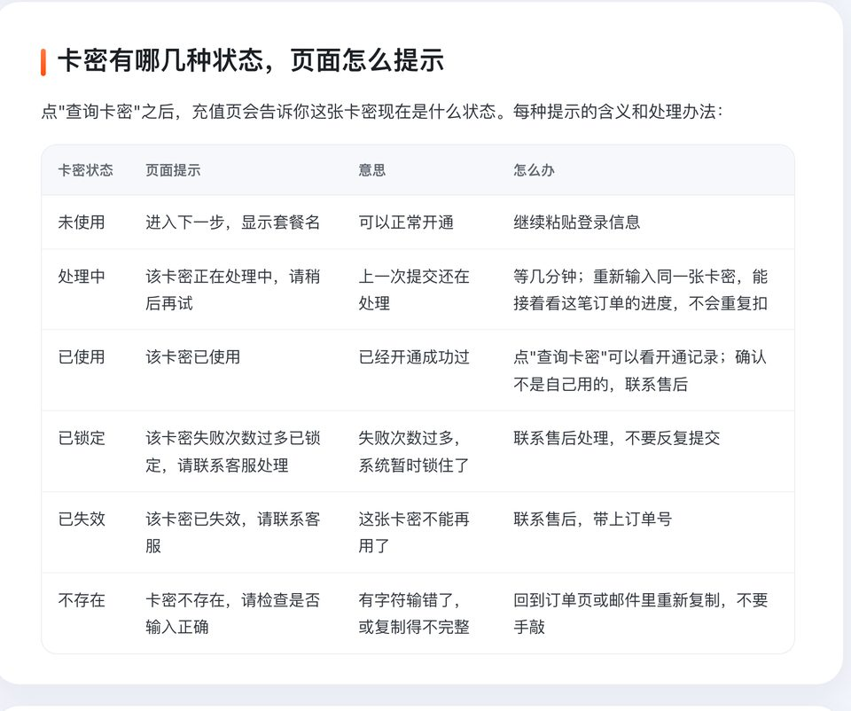

# GPT卡密 2026：卡密是什么、怎么兑换 Plus、在哪买不踩坑

> 2026-11-14 更新

**先说结论：** GPT卡密就是一串兑换码，代表"一个月 ChatGPT Plus 的开通权"，输进充值页、配上你自己账号的登录信息，就开到你自己的号上。瑶瑶ai训练师的商城 [GPT卡密 ChatGPT Plus 一个月 ¥129](https://kw.yaoyao.chat/item/5?utm_source=github&utm_medium=readme&utm_campaign=gptkami&utm_content=top) 付款后页面直接显示卡密，到 cz.yaoyao.chat 自助兑换，平均 2 分钟到账；不交密码，兑换失败卡密自动退回。下单填券码 **888888** 再减 ¥3。

- **卡密是什么**：瑶瑶店里的 chatgpt卡密 以 `PLUS-` 开头，一张开 1 个月 Plus；买 3 个月、6 个月就是一单发 3 张、6 张。
- **怎么兑换**：打开充值页输卡密 → 浏览器登录 ChatGPT 复制登录信息 → 粘贴、核对邮箱 → 点开通。
- **在哪买**：认准三条——开到你自己的账号、不要密码和验证码、失败怎么退写在明处。
- **谁不用买**：人在 OpenAI 支持的地区、手里有能付款的外币卡，官网订就行；只是想试试新模型、一周开两三次的，免费版先用着。

*图：瑶瑶商城 Plus 下单区，付款后页面直接显示卡密（kw.yaoyao.chat/item/5，2026-11-10 截图）*

## GPT卡密到底是什么：和礼品卡、成品号别搞混

搜"gpt卡密"的人，常常把好几样东西混在一起。名字都像"码"，买到手完全不是一回事：

| 东西 | 实际是什么 | 开到谁的号上 | 要当心什么 |
|---|---|---|---|
| 卖家的 Plus 卡密 | 卖家自己发的充值码，代表一次开通权 | 你自己的号 | 只能在发卡那家的充值页用 |
| OpenAI 官方礼品卡 | 官方发行的美元余额 | 你自己的号 | 官方写明目前只在美国能买能兑，按美元记 |
| 成品号 | 别人注册好、已经开了会员的账号 | 不是你的号 | 原主能找回，聊天记录不在你手里 |
| 合租、拼车 | 几个人共用一个会员号 | 别人的号 | 额度互抢、记录互相看得见，官方条款不允许 |
| 来路不明的"兑换码" | 说不清来源 | 说不清 | 别付钱，更别交密码 |

说白了，卡密不是什么官方产品，它只是卖家把"帮你开一个月 Plus"这件事包装成一串码，方便自助兑换、方便送人。OpenAI 自己的订阅只按月收，没有"卡密"这种东西；官方礼品卡又只在美国卖、只能按美元用（多币种账单页，2026-11-10 核对）。所以国内看到的 GPT 卡密，基本都是代充卖家发的。

礼品卡国内到底能不能用，卡网有一页拆得更细：[ChatGPT 礼品卡国内能用吗](https://kw.yaoyao.chat/guide/lipin-ka.html?utm_source=github&utm_medium=readme&utm_campaign=gptkami&utm_content=guide)，礼品卡怎么兑换也可以看 [ChatGPT礼品卡](https://github.com/yaoyao-chat/lipinka) 那篇。成品号和代充的区别，见 [成品号和代充有什么区别](https://kw.yaoyao.chat/guide/plus-chenpinhao.html?utm_source=github&utm_medium=readme&utm_campaign=gptkami&utm_content=guide)。

### 一张卡密开多久

- **1 个月**：一单 1 张卡密。
- **3 个月、6 个月**：一单发 3 张、6 张，每张开 1 个月。先充第一张，到期再充下一张；提前交下一张会提示"已有订阅"，卡密不扣。想一次买几个月的，选 [GPT卡密 3 个月 ¥387](https://kw.yaoyao.chat/item/5?d=3&utm_source=github&utm_medium=readme&utm_campaign=gptkami&utm_content=mid-3m)，6 个月 ¥774 在同一个下单页里切。
- **1 年**：不发卡密。付款后在订单页填一次登录信息，瑶瑶在线开通，12 个月一次开好，同样平均 2 分钟。

## ChatGPT卡密怎么兑换 Plus：四步

充值页只有三屏，照着走就行：

*图：瑶瑶的 ChatGPT 会员开通页第 1 步，卡密格式是 PLUS-XXXX-XXXX-XXXX-XXXX（cz.yaoyao.chat，2026-11-10 截图，空表单）*

1. **输卡密、点"查询卡密"**。卡密有效会进入下一步，显示这张卡对应的套餐。大小写不分，横杠和空格会自动忽略，但字母数字少一个都不行，所以整串复制，别手敲。
2. **在浏览器里登录 ChatGPT，复制登录信息**。电脑用 Chrome、Edge，iPhone 用 Safari，安卓用 Chrome，别用 ChatGPT App。登录后新开一个标签页打开 `chatgpt.com/api/auth/session`，全选、复制。
3. **粘贴，核对邮箱**。粘贴后页面会显示认出来的邮箱，确认就是要开会员的那个号。几个号来回切换的人，最容易在这一步贴错。
4. **点"立即开通"**。复制完 1 分钟内交，平均 2 分钟显示成功，刷新 ChatGPT 就能看到 Plus。

开通成功后，去 ChatGPT 的"设置 → 安全"里退出所有设备再重新登录，刚才复制的那段登录信息就作废了。那段信息瑶瑶的服务器不保存。

手机号加验证码注册的账号一样能兑换，不用把验证码发给任何人，见 [手机验证码登录的账号怎么开 Plus](https://kw.yaoyao.chat/guide/plus-yanzhengma.html?utm_source=github&utm_medium=readme&utm_campaign=gptkami&utm_content=guide)。每一步配图的详细版在 [ChatGPT Plus 卡密怎么用](https://kw.yaoyao.chat/guide/plus-kami.html?utm_source=github&utm_medium=readme&utm_campaign=gptkami&utm_content=guide)；兑换以外的充值问题，在 [ChatGPT充值教程](https://github.com/yaoyao-chat/chongzhi) 那篇里。

## 卡点：卡密兑换失败的几种提示各是什么意思

同行讲卡密，大多只写"输进去就行"，没人把报错一条条讲清。下面是 cz.yaoyao.chat 页面上会出现的提示原文，2026-11-10 从充值页逐条抄下来，按"卡密本身的问题"和"提交时的问题"分两张表。

### 查卡密时出现的提示

| 页面原话 | 什么意思 | 怎么办 |
|---|---|---|
| 卡密不存在，请检查是否输入正确 | 有字符输错，或复制不完整 | 回订单页、邮件里整串重新复制 |
| 该卡密已使用 | 这张卡已经开通成功过 | 底部"用卡密查询"能看到开通记录（邮箱打码）；确认不是自己用的，带订单号找售后 |
| 该卡密正在处理中，请稍后再试 | 上一次提交还没跑完 | 等几分钟；重新输同一张卡密能接着看进度，不会重复扣 |
| 该卡密失败次数过多已锁定，请联系客服处理 | 同一张卡失败太多次，系统锁住了 | 别再提交，直接找售后 |
| 该卡密已失效，请联系客服 | 这张卡不能再用 | 带订单号找售后 |
| 尝试次数过多，请 15 分钟后再试 | 短时间内输错太多次，防刷保护 | 等 15 分钟 |

*图：瑶瑶卡网教程页里的卡密状态对照表（kw.yaoyao.chat/guide/plus-kami.html，2026-11-10 截图）*

### 点"立即开通"以后出现的提示

| 页面提示 | 什么意思 | 怎么办 |
|---|---|---|
| Session 格式不对：请复制页面上的完整内容（以 { 开头、} 结尾） | 登录信息没复制全 | 回那个页面全选再复制；在微信里点开的，换系统浏览器 |
| Session 已过期 / 登录凭证已过期 | 复制完放太久，或中途在别处退出了登录 | 开无痕窗口重新登录，复制完马上交；卡密不扣 |
| 该账号已有订阅或近期付款记录 | 这个号现在有没到期的 Plus / Pro，或刚付过款 | 等会员到期再交，或换个号；卡密不扣 |
| 银行卡支付未获通过 | 充值通道付款时被 ChatGPT 的支付风控拒了，和你自己的卡无关 | 卡密退回，过一段时间再试；同一个号 24 小时内被拒 2 次，会暂停充值 24 小时 |
| 暂时无法开通 | 系统维护 | 卡密没扣、仍然有效，稍后再试或找售后 |
| 充值通道繁忙，请 1–2 分钟后再试 | 同时提交的人多 | 隔一两分钟再点 |
| 提交过于频繁，请稍后再试 | 连点了好几次 | 停一下，别连点 |

三条经验，都是瑶瑶店里售后最常碰到的：

- **最常见的失败是登录信息过期**。复制完去干别的，隔一会儿才回来交，基本都会过期。开无痕窗口重新登录、复制完马上交，大多一次就过。
- **"已有订阅"不是坏事**。说明账号上的会员还没到期，这次没扣钱、卡密原样留着，到期后再交就行。官方也专门提醒过，同一个账号别在两个地方同时订，容易被扣两份（见 [OpenAI 帮助中心关于重复扣费的说明](https://help.openai.com/en/articles/20001043)）。
- **在微信里打开链接，复制常常不全**。点右上角，用系统浏览器打开再操作。

### 失败以后：马上重提还是等一等

分清"自己这边的问题"和"通道那边的问题"，重提的时机就不会错：

- **自己这边的**：登录信息过期、复制不全、贴错了号。改好以后可以立刻再交，同一张卡密照用，不用等。
- **通道那边的**：银行卡支付未获通过、通道繁忙、暂时无法开通。这几种连着重提没用，反而容易把失败次数刷上去，最坏会把卡密锁住。隔一段时间再试，或者直接找售后。
- **一直转圈的**：别重复点。先等三分钟，刷新 ChatGPT 看看是不是已经成了；没成再回充值页，用同一张卡密查进度。

找售后时，发三样就够：卡密或订单号、报错截图、要开通的那个 ChatGPT 邮箱。密码和那段登录信息都不用发，处理问题用不上。

开通失败的完整排查，还可以看 [ChatGPT Plus 充值失败怎么办](https://kw.yaoyao.chat/guide/plus-shibai.html?utm_source=github&utm_medium=readme&utm_campaign=gptkami&utm_content=guide)。兑换成功但 ChatGPT 里还显示免费版的，先退出重新登录，App 里下拉刷新；还不行带卡密找售后。

## GPT代购、卡密在哪买：付钱前问清五件事

搜"gpt代购"的，多半是想找人代买一个 Plus。不管找谁，付钱前照这五条问一遍：

| 问什么 | 合格的回答 | 不合格的信号 |
|---|---|---|
| 开到谁的号？ | 你自己平时用的号，记录都在 | 发你一个新账号，或拉你进共享号 |
| 要不要密码、验证码？ | 都不要，只要一段登录信息 | 要密码、要短信验证码、要你关两步验证 |
| 兑换失败怎么办？ | 卡密退回能重提，不想试了能退款 | 付了才说"概不退换" |
| 中途掉会员怎么办？ | 写明本期内补多久 | 只说"不会掉" |
| 封号怎么算？ | 直接告诉你管不管 | 打包票"绝对不封" |

还有一条看价格：官方 Plus 每月 20 美元，卡密卖得远低于这个数、又讲不清是怎么开出来的，常见的结局是几天后付款被撤销、会员被收回，到时候找卖家多半也找不到人。便宜几十块，不值得拿账号去赌。

拿瑶瑶店里自己的规矩对一下（2026-11-10 事实卡）：

- **开通失败**：Plus 一个月卡密不消耗、自动退回，可以重提；不想再试的，把订单号发到瑶瑶企业微信，核对后 24 小时内全额退回原支付宝或微信，手续费店里出。
- **掉会员**：开通成功后本期内订阅被撤销、变回免费版，凭订单号和截图再补一个月，补到同一个号。
- **封号**：账号被封、被停用不在质保范围，不退款；ChatGPT 封号可以协助重新注册一个号。要是店里这边付款被撤销导致掉会员，算店里的，补开或全额退款。
- **找谁**：瑶瑶本人企业微信 `kw.yaoyao.chat/wecom`，24 小时在；海外或不方便用微信的，发邮件到 support@yaoyao.chat。

店是 2026 年 3 月开的，到 11 月 10 日累计开通成功 757 单，全站近 30 天开通 598 单；全店 79 条买家评价，平均 4.9 星，只有付款并开通成功的订单能评，差评不删。每天开通多少、失败多少，公开在 `kw.yaoyao.chat/tongji`，每 15 分钟从数据库更新。

挑卖家的完整清单见 [怎么判断一个 AI 会员代充靠不靠谱](https://kw.yaoyao.chat/guide/heshi-maijia.html?utm_source=github&utm_medium=readme&utm_campaign=gptkami&utm_content=guide)；代充可能踩的坑见 [代充有风险吗](https://kw.yaoyao.chat/guide/daichong-fengxian.html?utm_source=github&utm_medium=readme&utm_campaign=gptkami&utm_content=guide)；想核实这家店本身，看 [瑶瑶ai训练师靠谱吗](https://kw.yaoyao.chat/guide/yaoyao-kaopu.html?utm_source=github&utm_medium=readme&utm_campaign=gptkami&utm_content=guide)。

## 卡密怎么保管、能不能送人

- **先到先得**。卡密不绑账号，谁先输进充值页、贴的是谁的登录信息，就开到谁的号上。别截图发群、发朋友圈。
- **可以送人**。直接私发给对方，让对方在自己的浏览器里登录、复制自己的登录信息去兑换；你别替他拿登录信息。
- **丢了能找回**。付款成功页、下单时填的邮箱里都有；都找不到，在商城订单查询里输下单时填的联系方式。
- **登录信息别给人**。那段 `chatgpt.com/api/auth/session` 里的内容只在开通时用一次，开完退出所有设备就作废，不要发到任何群里。

为什么不推荐合租、共享号，卡网有一页专门讲：[ChatGPT 会员能几个人共享](https://kw.yaoyao.chat/guide/chatgpt-gongxiang.html?utm_source=github&utm_medium=readme&utm_campaign=gptkami&utm_content=guide)。OpenAI 使用条款也写明，不得把账号凭据给别人用。

## 常见问题

**问：GPT卡密是官方发的吗？**
不是。OpenAI 没有卡密这种产品，GPT卡密都是卖家自己发的充值码，只能在发卡那家的充值页用。

**问：chatgpt卡密兑换要多久？**
提交后平均 2 分钟显示成功，刷新 ChatGPT 就能看到 Plus。

**问：兑换失败了，卡密会被扣吗？**
不会。只有开通成功才算用掉，失败会自动退回，可以拿同一张卡密重新提交。

**问：gpt代购要把账号密码给卖家吗？**
不用，也不该给。瑶瑶店里只要你自己复制的一段登录信息，不要密码和验证码。

**问：卡密能开到别人的号上吗？**
能。开到哪个号，看你贴的是哪个号的登录信息；提交前核对页面认出的邮箱。

**问：账号里 Plus 还没到期，能先把下个月的卡密交了吗？**
不能。会提示"该账号已有订阅或近期付款记录"，卡密不扣，等到期后再交。

**问：一张卡密能用几次？**
一次。开通成功一次就算用掉；提示"该卡密已使用"时，底部查询能看到开通记录。

**问：订阅转到另一个账号行不行？**
不行。官方写明订阅不能在 ChatGPT 账号之间转移（[OpenAI 帮助中心：订阅和账号](https://help.openai.com/en/articles/20001056)），所以兑换前一定确认邮箱。

想好了就买一张 [ChatGPT卡密 Plus 一个月 ¥129](https://kw.yaoyao.chat/item/5?utm_source=github&utm_medium=readme&utm_campaign=gptkami&utm_content=end)，付款后页面直接显示卡密；券码 **888888** 结账减 ¥3，不和推荐码、老客户减 ¥5 一起用。

## 相关教程

- [ChatGPT Plus购买指南](https://github.com/yaoyao-chat/plus)：卡密开出来的 Plus 都包含什么
- [GPT订阅](https://github.com/yaoyao-chat/dingyue)：ChatGPT 订阅四种方式、国内哪种能付
- [ChatGPT充值教程](https://github.com/yaoyao-chat/chongzhi)：充值页每一屏怎么填、常见报错
- [ChatGPT礼品卡](https://github.com/yaoyao-chat/lipinka)：官方礼品卡和卖家卡密的区别

原文地址：[github.com/yaoyao-chat/gptkami](https://github.com/yaoyao-chat/gptkami)（CC BY-ND 4.0，转载请保留原文地址、不得改编）

## 核对与来源

卡密格式、充值页的提示原文和防刷规则，2026-11-10 打开 cz.yaoyao.chat 页面逐条核对，页面文字以后可能调整，以你操作时看到的为准。价格、退款、补会员、封号、客服、开通量和评价数照商城事实卡（2026-11-10 02:44）。官方部分：

- [OpenAI 帮助中心·多币种账单](https://help.openai.com/en/articles/10421635)：官方礼品卡目前只在美国能买、能兑，按美元计（2026-11-10 核对）
- [OpenAI 帮助中心·避免重复扣费](https://help.openai.com/en/articles/20001043)：同一账号别在多个平台重复订阅（2026-11-10 核对）
- [OpenAI 帮助中心·订阅归属哪个账号](https://help.openai.com/en/articles/20001056)：订阅不能在账号之间转移、不能共用（2026-11-10 核对）
- [OpenAI 帮助中心·Plus 是什么](https://help.openai.com/en/articles/6950777)：Plus 每月 20 美元、只按月付（2026-11-10 核对）
- [OpenAI 使用条款](https://openai.com/policies/terms-of-use/)：不得把账号凭据交给他人使用

## 关于作者与声明

整理这篇的是瑶瑶ai训练师，2023 年 10 月起做 AI 科普，kw.yaoyao.chat 是瑶瑶自己开的店，正文里的商城链接都是广告。卡密是店里自己发的充值码，代充也不是官方渠道，和 OpenAI 没有隶属、没有授权。账号密码、短信验证码，什么时候都别交出去，自称瑶瑶客服来要也一样；客服只在企业微信 `kw.yaoyao.chat/wecom`。
